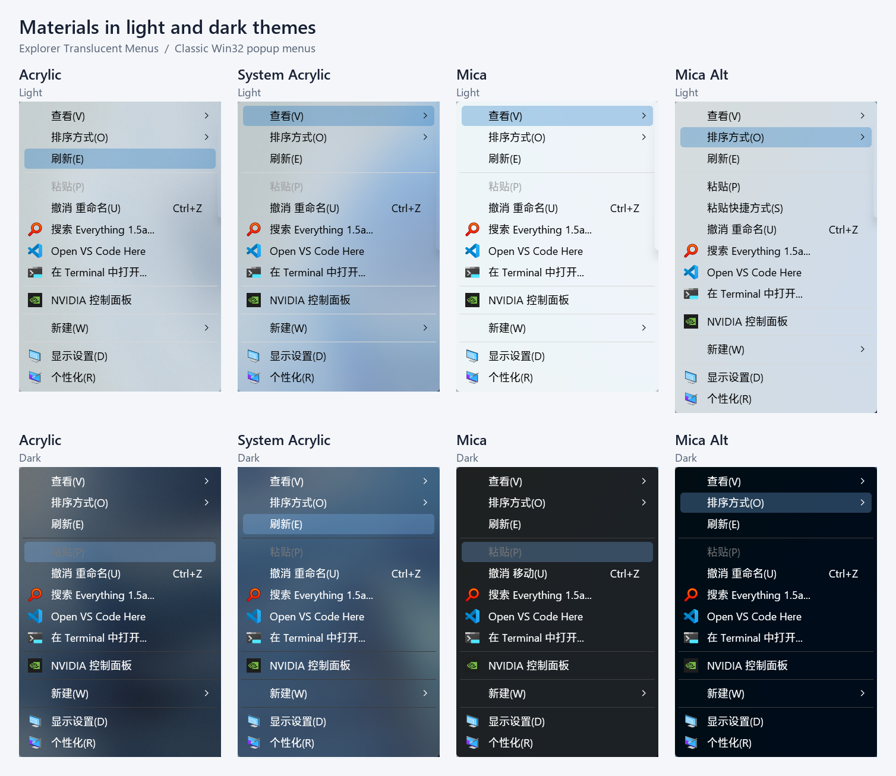
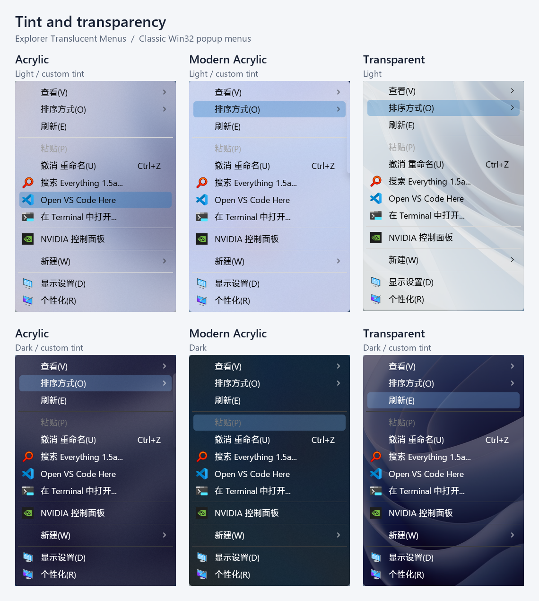
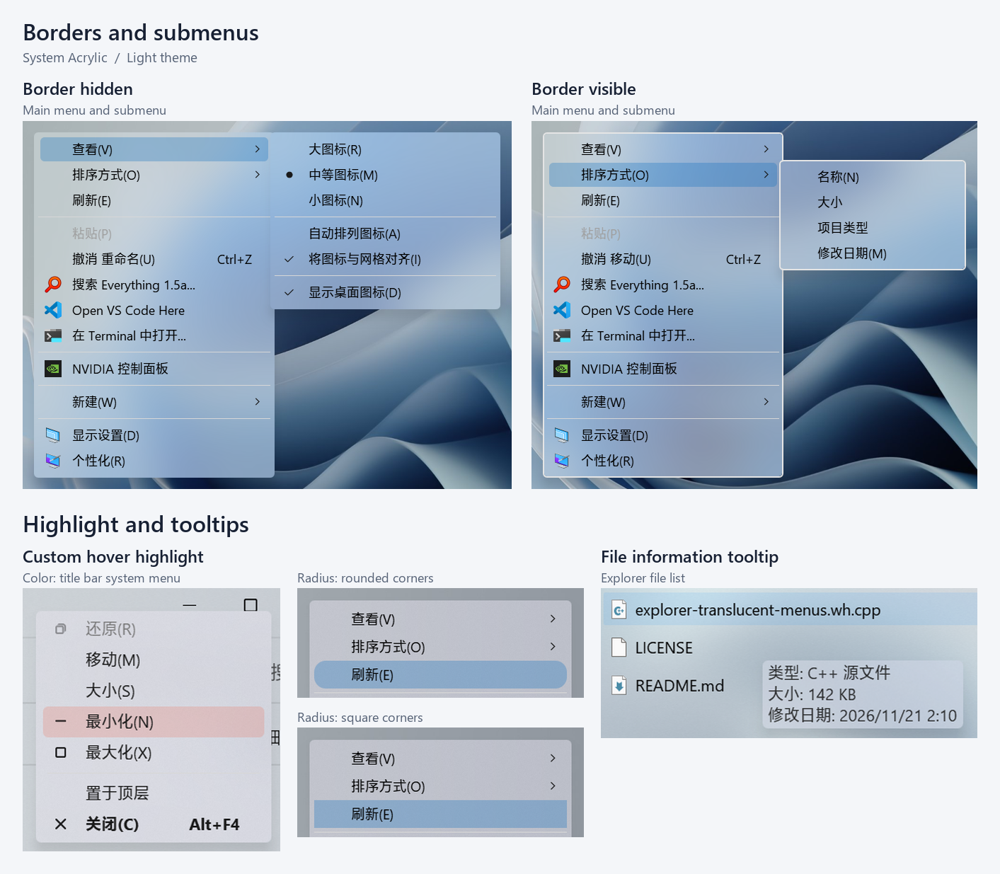

# Explorer Translucent Menus

Apply translucent materials to classic Win32 popup menus in File Explorer.
Windows continues to provide menu items, layout, commands, keyboard navigation,
and shell extensions. Windows 11's modern context menu is left unchanged.

This is an Explorer-only, menu-focused alternative to the archived
[TranslucentFlyouts](https://github.com/ALTaleX531/TranslucentFlyouts) project.
It covers classic popup menus hosted by `explorer.exe`, including desktop and
File Explorer context menus. It leaves the main Explorer window background,
ordinary controls, and other processes unchanged.

## Screenshots

Materials in light and dark themes

Tint and transparency adjustments

Borders, submenus, hover highlights, and file tooltips

## Requirements

- Windows 11 22H2 or later (build 22621+), 64-bit.
- Desktop composition and Windows transparency effects enabled.
- No other renderer modifying the same Explorer menus.

To open a classic context menu on Windows 11, select **Show more options** or
use **Shift+F10**. Select **Native** to disable all hooks. For a temporary bypass,
enable **Hold Ctrl to bypass** in the settings, then hold **Ctrl** before opening
a menu.

## Materials

| Material | Tint opacity |
| --- | --- |
| Native | No modifications |
| Solid | Always opaque |
| Transparent | Adjustable, no blur |
| Acrylic | Adjustable tint over blur |
| Modern Acrylic | Adjustable tint color, fixed opacity |
| System Acrylic | Fixed Windows recipe |
| Mica / Mica Alt | Fixed Windows recipes |

Tint opacity changes the material, not text or icons. Theme selection controls
the light or dark palette.

**Hover highlight color** accepts `#RRGGBB` (for example, `#FF6A00`).
The default `auto` keeps the existing light and dark colors; invalid values
also use those colors. Opacity is adjustable separately.
The corner radius and inset are measured in device-independent pixels (DIP).
These settings have no effect when highlight opacity is 0 (native highlight).

## Appearance

Enable **Hide menu border** to suppress the outline on modified menus. This
preserves menu dimensions and works with rounded or square corners. Native
mode and Ctrl bypass retain the complete Windows appearance.
The option also protects the outline setting from later Shell/UxTheme updates
while the modified menu is being tracked.
When disabled, the theme draws the native border both during the opening
animation and on later repaints.

Enable **Apply material to title bar menu** to also style File Explorer's
window menu, opened by right-clicking the title bar or pressing `Alt+Space`.
This option is off by default. It uses the same material, theme, border,
corner, highlight, and mouse click animation settings as context menus.
Opening animations and keyboard command activation remain native.

Enable **Apply material to file information tooltips** to give File Explorer's
file-list InfoTips the same material, tint, theme, corners, and border setting.
The option is off by default. Windows still supplies the text, layout, hover
delay, and animations. A tooltip keeps its material through the native fade-out.
Navigation, toolbar, and taskbar tooltips are unchanged.
Unloading or reloading the mod clears its state from existing tooltip windows
before they can be reused.

### Menu item click animation

**Menu item click animation** offers three choices after mouse selection:

| Choice | Behavior after clicking a command |
| --- | --- |
| Windows animation | Keep the system selection fade, including its possible black background |
| Close immediately | Dismiss without a selection fade |
| Recreate fade animation (default) | Fade a snapshot of the fully composited item for 350 ms |

Replay captures the visible hover appearance before the pressed-state paint,
including the material, text, and icons. The fade is clipped to the custom
highlight even when Windows drew the item offscreen. The non-interactive
overlay runs on a separate thread, so menu command delivery does not wait
for it to show or finish the fade.
It respects Windows' selection-fade and UI-effects settings and never changes
global animation preferences.

Instant and Replay use the tracked root menu's `MNS_NOTIFYBYPOS` style for
command notifications and return values, including selections in submenus.

Legacy icon repair converts copied RGB bitmaps to premultiplied alpha. Optional
background removal clears only matching corner-connected white, black, or
magenta regions. Disable background removal for icons with intentional borders.
Transfers that declare per-pixel alpha, and bitmaps with ambiguous partial
alpha, retain the original GDI behavior. The mod does not guess whether an
existing alpha bitmap is straight or premultiplied.

## Scope and rendering approach

This mod keeps the Shell's immersive owner-draw enabled and preserves native
menu layout, commands, and shell extensions. Effects are scoped to supported
classic popups while a menu is tracked. Preparation validates resources before
applying effects and exposes the popup to drawing hooks only after commit.
Only successful state changes are recorded for cleanup. Memory DCs are left
to Windows unless they match the exact target of a synchronous Shell
`WM_DRAWITEM` or native popup drawing message. This preserves the native
opening animation for menus drawn offscreen, including scrollbar context menus.
GDI and UxTheme hooks are installed in Explorer, but forward to Windows outside
a tracked menu. The scope is the popup effect, rather than a replacement for
Explorer's overall interface rendering.

[Translucent Windows](https://windhawk.net/mods/translucent-windows) and
[Win32 UI Modernizer](https://windhawk.net/mods/win32-ui-modernizer) already
offer translucent classic menus. Translucent Windows shares background-effect
configuration between windows and flyouts, with menu drawing integrated into
its broader theme-rendering path. Win32 UI Modernizer lets users disable its
Explorer section and other general features, but its modern menu modes disable
immersive owner-draw and also modernize ComboBox dropdowns.

The purpose of this separate implementation is to provide a dedicated popup
renderer that retains the Shell's owner-draw path and can accompany a separate
Explorer background renderer. Restricting process targets or adding material
presets alone does not provide that rendering behavior. An equivalent mode in
a broader UI mod would need to isolate menu rendering and preserve immersive
owner-draw as well.

## Compatibility

Do not enable this mod alongside another renderer modifying the same Explorer menus.

- **Translucent Windows:** disable **Windows theme custom rendering** and **Flyout effects** to remove its direct flyout rendering.
- **Win32 UI Modernizer:** set **Menus and dropdowns** to **Native (no modernization)**.

Other enabled features may still affect Explorer's shared drawing paths.
To continue using those mods in other applications while avoiding their Explorer hooks,
exclude `explorer.exe` from their targets.

This mod leaves Explorer's main window backdrop untouched and can complement ExplorerBlurMica.

Compatible with WinUI Context Menu Animation (disable Fade-in and enable
Translucent Windows compatibility mode).

Including other processes (such as `taskmgr.exe`) can also apply the effects of this
mod to the Win32 menus of those processes. However, this mod is designed for
`explorer.exe` and has not been extensively tested with other processes.

The implementation uses version-dependent Windows interfaces: the composition
attribute exports, UxTheme ordinal 74, the DarkMode::Menu theme, native menu
layout, activation and drawing messages, and Shell window properties. It does not
read private Shell item structures, patch instructions, download symbols, or
replace the menu loop.

## Troubleshooting

Enable log output in Windhawk's Advanced tab to record menu preparation,
material and border application results, native fallback reasons, and cleanup.
There is no separate logging setting in this mod. Native mode registers no
menu hooks, so it reports initialization rather than individual menu openings.

For the title bar option, the initialization line reports `titleBarMenu=1`
when enabled. Look for `Title bar menu` owner, entry, and system-menu lines,
followed by the material result. With Windhawk logging disabled, these lines
are not emitted even if the mod is loaded.

For file-list InfoTips, look for `fileInfoTips=1` at initialization and a
`File InfoTip` line when a tooltip receives the material.

## Credits and license

Informed by [TranslucentFlyouts](https://github.com/ALTaleX531/TranslucentFlyouts),
[Translucent Windows](https://windhawk.net/mods/translucent-windows), and
[Custom Cached Context Menu](https://github.com/Bolt-Scripts/custom-cached-context-menu).
This implementation is distributed under GPL-3.0-or-later.
