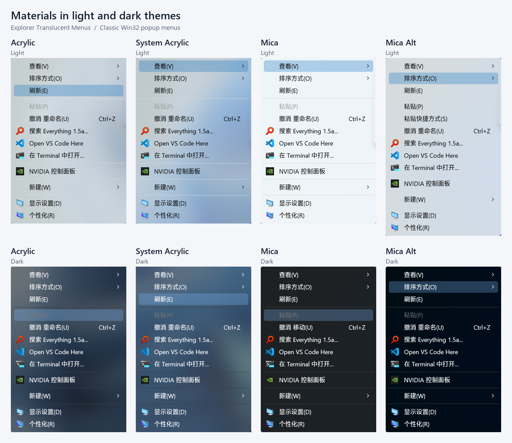
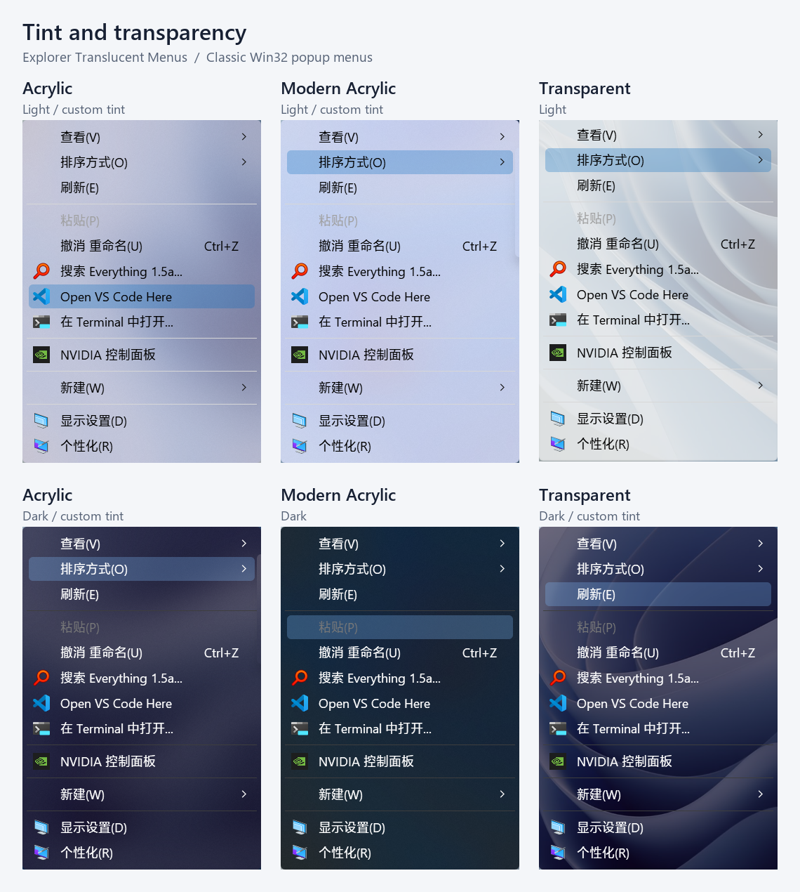
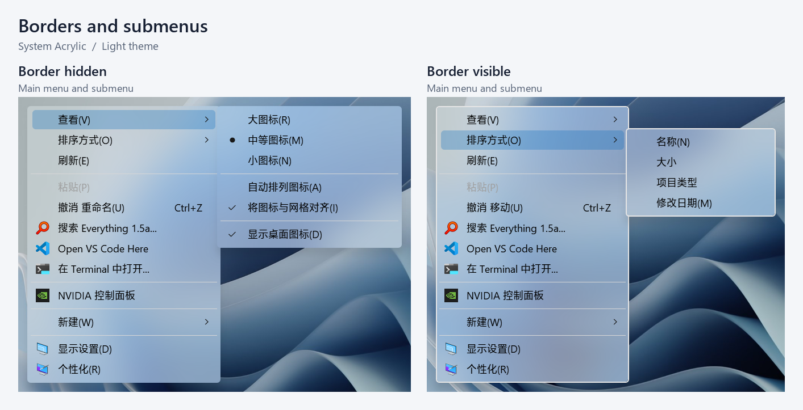

# Explorer Translucent Menus

Apply translucent materials to classic Win32 popup menus in File Explorer.
Windows continues to provide menu items, layout, commands, keyboard navigation,
and shell extensions. Windows 11's modern context menu is left unchanged.

This is an Explorer-only, menu-focused alternative to the archived
[TranslucentFlyouts](https://github.com/ALTaleX531/TranslucentFlyouts) project.
It covers classic popup menus hosted by `explorer.exe`, including desktop and
File Explorer context menus. It leaves the main Explorer window background,
ordinary controls, and other processes unchanged.

## Screenshots

Materials in light and dark themes

Tint and transparency adjustments

Borders and submenus

## Requirements

- Windows 11 22H2 or later (build 22621+), 64-bit.
- Desktop composition and Windows transparency effects enabled.
- No other renderer modifying the same Explorer menus.

To open a classic context menu on Windows 11, select **Show more options** or
use **Shift+F10**. Select **Native** to disable all hooks. For a temporary bypass,
enable **Hold Ctrl to bypass** in the settings, then hold **Ctrl** before opening
a menu.

## Materials

| Material | Tint opacity |
| --- | --- |
| Native | No modifications |
| Solid | Always opaque |
| Transparent | Adjustable, no blur |
| Acrylic | Adjustable tint over blur |
| Modern Acrylic | Adjustable tint color, fixed opacity |
| System Acrylic | Fixed Windows recipe |
| Mica / Mica Alt | Fixed Windows recipes |

Tint opacity changes the material, not text or icons. Theme selection controls
the light or dark palette. Hover highlight opacity can be adjusted separately.
Unrecognized saved material values use Acrylic.

## Appearance

Enable **Hide menu border** to suppress the outline on modified menus. This
preserves menu dimensions and works with rounded or square corners. Native
mode and Ctrl bypass retain the complete Windows appearance.
The option also protects the outline setting from later Shell/UxTheme updates
while the modified menu is being tracked.

Legacy icon repair converts copied RGB bitmaps to premultiplied alpha. Optional
background removal clears only matching corner-connected white, black, or
magenta regions. Disable background removal for icons with intentional borders.
Transfers that declare per-pixel alpha, and bitmaps with ambiguous partial
alpha, retain the original GDI behavior. The mod does not guess whether an
existing alpha bitmap is straight or premultiplied.

## Scope and rendering approach

This mod keeps the Shell's immersive owner-draw enabled and preserves native
menu layout, commands, and shell extensions. Effects are scoped to supported
classic popups while a menu is tracked. Preparation validates resources before
applying effects and exposes the popup to drawing hooks only after commit.
Only successful state changes are recorded for cleanup. Unassociated memory
DCs are left to Windows; owner-draw memory DCs require an exact synchronous
WM_DRAWITEM match.
GDI and UxTheme hooks are installed in Explorer, but forward to Windows outside
a tracked menu. The scope is the popup effect, rather than a replacement for
Explorer's overall interface rendering.

[Translucent Windows](https://windhawk.net/mods/translucent-windows) and
[Win32 UI Modernizer](https://windhawk.net/mods/win32-ui-modernizer) already
offer translucent classic menus. Translucent Windows shares background-effect
configuration between windows and flyouts, with menu drawing integrated into
its broader theme-rendering path. Win32 UI Modernizer lets users disable its
Explorer section and other general features, but its modern menu modes disable
immersive owner-draw and also modernize ComboBox dropdowns.

The purpose of this separate implementation is to provide a dedicated popup
renderer that retains the Shell's owner-draw path and can accompany a separate
Explorer background renderer. Restricting process targets or adding material
presets alone does not provide that rendering behavior. An equivalent mode in
a broader UI mod would need to isolate menu rendering and preserve immersive
owner-draw as well.

## Compatibility

Menu effects from these mods conflict when enabled on the same Explorer popups:

- [Translucent Windows](https://windhawk.net/mods/translucent-windows):
  **Flyout effects** also renders classic menus, dropdowns, and tooltips.
  Disable that option to remove its flyout effects.
- [Win32 UI Modernizer](https://windhawk.net/mods/win32-ui-modernizer): set
  **Menus and dropdowns** to **Native (no modernization)**. Both modern modes
  apply their own acrylic rendering and disable immersive owner-draw.

These settings turn off their direct menu features. Their remaining Explorer
effects and shared drawing hooks depend on other settings, so compatibility
must be evaluated with the configuration in use. To avoid their remaining hooks
in Explorer while continuing to use them in other applications, exclude
`explorer.exe` from their targets in Windhawk's Advanced tab.

This mod is also compatible with
[ExplorerBlurMica](https://github.com/Maplespe/ExplorerBlurMica), which supplies
the main Explorer window backdrop. This mod keeps its effects confined to classic
popup menus and leaves the main window backdrop to ExplorerBlurMica.

Unknown owner-drawn menus, custom background brushes, high contrast, remote
sessions, disabled transparency, and recognized conflicting renderers are
left unchanged. Settings changes reload the mod. Active effects suppress the
native bitmap opening animation to avoid an opaque initial snapshot.

Menus whose previous system-backdrop value cannot be read stay native. Unreadable
optional dark-mode and corner preferences are left unchanged. Recorded values
are restored on live-window cleanup; failed restores remain pending for retry.
There are no public getters for prior blur regions or extended-frame margins,
and the Accent getter is unavailable on some builds. Cleanup of those states is
best-effort, not a lossless restoration guarantee for an unknown renderer. A
missing border-color snapshot likewise uses the Windows default on cleanup.
Destroyed popup HWNDs release their window-owned effects without extra resets.

The implementation uses version-dependent Windows interfaces: the composition
attribute exports, UxTheme ordinal 74, the DarkMode::Menu theme, menu layout
message 0x1e2, and Shell window properties. It does not read private Shell item
structures, patch instructions, download symbols, or replace the menu loop.

## Troubleshooting

Enable log output in Windhawk's Advanced tab to record menu preparation,
material and border application results, native fallback reasons, and cleanup.
There is no separate logging setting in this mod. Native mode registers no
menu hooks, so it reports initialization rather than individual menu openings.

## Credits and license

Informed by [TranslucentFlyouts](https://github.com/ALTaleX531/TranslucentFlyouts),
[Translucent Windows](https://windhawk.net/mods/translucent-windows), and
[Custom Cached Context Menu](https://github.com/Bolt-Scripts/custom-cached-context-menu).
This implementation is distributed under GPL-3.0-or-later.
